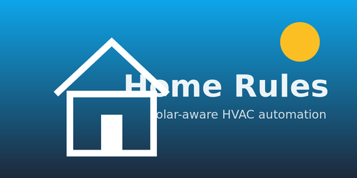

<p align="center">
  
</p>

# Home Rules

[![HACS][hacs-badge]][hacs-url]
[![GitHub Release][release-badge]][release-url]
[![Validate][validate-badge]][validate-url]
[![Home Assistant][ha-badge]][ha-url]

Solar-aware aircon automation for Home Assistant.

## Features

- Separates **Control Mode** (**Disabled / Monitor / Automatic**) from **Automatic Power Use**.
- Exposes decision sensors so you can see why a mode/action was chosen.
- Can optionally send mode-change alerts to a `notify.*` target.
- Runtime integration code is intentionally compact to keep maintenance overhead low.

## Installation

Requires Home Assistant **2026.3.0** or newer.
Configuration forms support both Voluptuous and the Probatio schema backend introduced in Home Assistant 2026.10.

Install through HACS as a custom repository:
1. Add `https://github.com/teh-hippo/ha-home-rules` as an **Integration** repository.
2. Install **Home Rules**.
3. Restart Home Assistant.

## Configuration

Add **Home Rules** from Settings -> Devices & Services, select your entities, then tune options.
Home Rules manages its own aircon timer internally, so you do not need a separate `timer.*` helper entity.

`select.home_rules_control_mode` defaults to **Monitor** for safe setup.
Switch to **Automatic** once you are happy with decisions and want the integration to control your climate entity.

**Automatic Power Use** is a separate selector (`select.home_rules_power_policy`):

- **Solar only** (default): use generation thresholds to choose Cool or Dry; do not start while importing or discharging the battery beyond its tolerance.
  Existing automatic runs tolerate brief battery discharge or grid import, then stop after the configured **Paid-power tolerance**.
  Cool/Dry mode changes do not reset that tolerance.
- **Solar with battery/grid run-on**: starts require the same solar and temperature conditions as Solar only.
  An existing solar-started run can continue on battery/grid for the configurable **Solar run-on allowance**, default **60 minutes**, after the paid-power tolerance period.
  The allowance preserves the current Cool/Dry mode and cannot start a fresh run.
  Brief solar recoveries do not reset its deadline; sufficient free solar must recover for at least the tolerance period (or one evaluation interval when tolerance is zero).
  Setting the allowance to zero disables run-on.
  Home Rules does not enforce a battery charge reserve; inverter protections remain external.

**Minimum off time** applies after every switch-off, including manual stops and timer expiry.
It uses elapsed minutes, not evaluation counts, and its deadline survives restarts.
Legacy reactivation settings are converted using their configured evaluation interval.
Manual starts remain possible during the automatic-start cooldown.

**Temperature control.** Normal automatic starts use **Comfort Temperature** (default 24°C) as the upper comfort boundary.
**Ideal Temperature** (default 22°C) is the target sent to the climate entity.
Comfort Temperature must be higher than Ideal Temperature to avoid repeated starts near the target.
The existing `number.home_rules_temperature_threshold` and `number.home_rules_cool_setpoint` entity IDs are retained.
An unavailable temperature sensor prevents automatic starts and cannot be treated as proof that the target has been reached.

Two independent device switches control what happens when the house reaches Ideal Temperature:

- **Stop at Ideal Temperature** (`switch.home_rules_stop_at_comfort_temperature`): stops automatic and manual Cool/Dry runs at the target when on.
  When off, cooling continues under the existing power rules and any manual timer cap.
- **Automatic Target Notifications** (`switch.home_rules_automatic_target_notifications`): enables information-only target-reached alerts for automatic runs, regardless of time.
  Manual target-reached alerts are always enabled and are not affected by this switch.

Automatic target notifications default on and target stopping defaults off.
Both require the temperature input to be available; notifications require a configured notification service.
Each run receives at most one successfully delivered target alert, including across HA restarts.
Changing the aircon setpoint does not change run ownership or Home Rules' saved temperature settings.
An automatic run respects the adjusted aircon setpoint until it ends, including across restarts.
The next automatic start uses the saved temperature settings; target-stop decisions still use Ideal Temperature.

Turning **Cooling Enabled** off stops existing automatic cooling and prevents new automatic starts, without blocking manual cooling.
Turning **Dry Mode Enabled** off during automatic Dry switches to Cool if eligible, otherwise stops the run.
Manual Dry remains allowed.

Two independent switches control occupancy-aware starts:

- **Only Cool When Home** requires Home Assistant's `zone.home` aggregate to contain at least one person before an automatic cooling or drying start.
  Home Rules subscribes to zone changes, so arrivals and departures are evaluated immediately rather than waiting for the next poll.
  A departure stops an automatic run unless it is covered by the full-battery exception.
  Manual cooling is not blocked.
- **Allow Away Cooling at Full Battery** permits an automatic cooling start while the house is empty once the configured battery state of charge reaches **Battery Full Threshold** (default 100%).
  The run remains authorised until the battery reaches **Battery Reserve** (default 80%), the room reaches its target, or existing safety conditions stop it.
  The reserve prevents a 99% reading immediately cancelling a run that started at 100%; Home Rules must see the full threshold again before a later away run can start.
  This switch has no effect unless Only Cool When Home is enabled.

Select a percentage battery state-of-charge sensor in options to use the full-battery exception.
Away battery-authorised cooling requires no net grid import at start and retains the configured paid-power tolerance for grid use during the run.
The existing 100 W battery-power noise floor is fixed.
Presence alone does not authorise a fresh battery or grid start; ordinary home-present starts still follow Automatic Power Use and require its normal solar conditions.

Saved Solar Cooling and Boost Cooling modes migrate to Automatic with Solar only and Solar with battery/grid run-on respectively.
The former unrestricted Allow battery and grid policy now permits bounded continuation only, not paid-power starts.
Existing comfort and ideal temperatures are preserved.
Legacy afternoon pre-cooling, tariff, and battery-discharge tolerance settings are removed during config-entry migration.
The former Manual cooling target behaviour option is replaced by the two switches: Auto off enables Stop at Ideal Temperature; Timer and Ask leave it off.
Automatic Target Notifications initially defaults on, and manual target alerts remain enabled regardless of the previous choice.

**Battery power (optional).** Select a battery power sensor in options to detect discharge.
Battery discharge readings up to 100 W are treated as noise.
Battery power is expected positive when discharging (GoodWe); enable the invert option if yours is the opposite.

Existing Cool/Dry sessions become automatic when the normal automatic-start temperature, solar and power checks qualify, including sessions with an active manual timer.
Adoption applies the automatic target temperature and clears the manual timer.
Otherwise, manually started cooling remains uncapped while free solar is available.
Once it uses battery/grid power or solar is unavailable, the configured timer cap starts independently of Automatic Power Use.
Automatic cooling does not receive a manual timer merely because battery/grid use is permitted.
Manual target alerts offer **Turn off**, **Keep running**, and **5 mins** buttons while cooling remains on; a target-based stop sends an information-only alert.
Interactive buttons require a Home Assistant Companion `notify.mobile_app_*` service.
No response or **Keep running** leaves the original deadline unchanged.
**5 mins** shortens the remaining timer to five minutes from the response, without extending a shorter remaining time.
If a manual run is still uncapped, **5 mins** explicitly starts a five-minute timer.
Target prompts and pending responses survive HA restarts, and buttons from completed or replaced timer sessions are ignored.
An expired manual timer still stops the run if solar generation recovers; only a still-active timer can be replaced by automatic cooling.
Unavailable temperature readings cannot trigger target prompts or target-based stops.
Heat and other non-cooling manual modes retain their timer-only behaviour.

Monitor runs the internal timer for the configured duration and exposes its remaining seconds through `sensor.home_rules_timer_countdown`, without controlling the aircon.

## Development

```bash
bash scripts/check.sh
```

Requires [uv](https://docs.astral.sh/uv/). Uses [Conventional Commits](https://www.conventionalcommits.org/).

## Troubleshooting

- Verify all configured entities exist and are available.
- Keep Control Mode in **Monitor** until behaviour matches expectations.
- Check Home Assistant logs for `home_rules` issues.

## License

MIT

[hacs-badge]: https://img.shields.io/badge/HACS-Custom-41BDF5.svg
[hacs-url]: https://github.com/hacs/integration
[release-badge]: https://img.shields.io/github/v/release/teh-hippo/ha-home-rules
[release-url]: https://github.com/teh-hippo/ha-home-rules/releases
[validate-badge]: https://img.shields.io/github/actions/workflow/status/teh-hippo/ha-home-rules/validate.yml?branch=master&label=validate
[validate-url]: https://github.com/teh-hippo/ha-home-rules/actions/workflows/validate.yml
[ha-badge]: https://img.shields.io/badge/HA-2026.3%2B-blue.svg
[ha-url]: https://www.home-assistant.io
