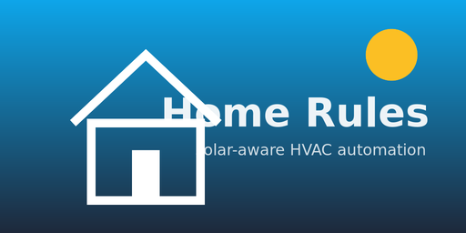

<p align="center">
  
</p>

# Home Rules

[![HACS][hacs-badge]][hacs-url]
[![GitHub Release][release-badge]][release-url]
[![Validate][validate-badge]][validate-url]
[![Home Assistant][ha-badge]][ha-url]

Solar-aware aircon automation for Home Assistant.

## Features

- Separates **Control Mode** (**Disabled / Monitor / Automatic**) from **Automatic Power Use**.
- Supports solar-powered afternoon pre-cooling with configurable start and finish times.
- Exposes decision sensors so you can see why a mode/action was chosen.
- Can optionally send mode-change alerts to a `notify.*` target.
- Runtime integration code is intentionally compact to keep maintenance overhead low.

## Installation

Install through HACS as a custom repository:
1. Add `https://github.com/teh-hippo/ha-home-rules` as an **Integration** repository.
2. Install **Home Rules**.
3. Restart Home Assistant.

## Configuration

Add **Home Rules** from Settings -> Devices & Services, select your entities, then tune options.
Home Rules manages its own aircon timer internally, so you do not need a separate `timer.*` helper entity.

`select.home_rules_control_mode` defaults to **Monitor** for safe setup.
Switch to **Automatic** once you are happy with decisions and want the integration to control your climate entity.

**Automatic Power Use** is a separate selector (`select.home_rules_power_policy`):

- **Solar only** (default): use generation thresholds to choose Cool or Dry; do not start while importing or discharging the battery beyond its tolerance.
  Existing automatic runs tolerate brief battery discharge or grid import, then stop after the configured **Paid-power tolerance**.
  Outside pre-cooling, reaching **Comfort Temperature** also stops the run, leaving remaining solar available for battery charging.
- **Allow battery and grid**: start Cool without requiring solar and let the aircon maintain the selected temperature, including overnight.
  This explicitly permits ongoing energy spending until you change the policy or turn the aircon off.
  Home Rules does not enforce a battery charge reserve; inverter protections remain external.

**Temperature control.** Normal automatic starts use **Start Temperature** (default 24°C).
**Comfort Temperature** (default 22°C) is the actual desired room temperature and the target sent to the climate entity.
Start Temperature must be higher than Comfort Temperature to avoid repeated starts near the target.
The existing `number.home_rules_temperature_threshold` and `number.home_rules_cool_setpoint` entity IDs are retained.
An unavailable temperature sensor prevents automatic starts and cannot be treated as proof that the target has been reached.

**Afternoon Pre-cooling** is an independent switch, initially off.
Enable it to use **Pre-cooling Temperature** (default 20°C) during the local-time window:

- `time.home_rules_pre_cooling_start`: defaults to **14:00**.
- `time.home_rules_pre_cooling_finish`: defaults to **17:00**.

Pre-cooling can start 1°C above its target, below the normal Start Temperature.
It lets the aircon maintain that target until the window ends, subject to Automatic Power Use.
Outside the window, the target returns to Comfort Temperature; Solar only stops an already-cool run.
Normal cooling remains available before and after the window, and pre-cooling does not resume when an evening tariff changes back to off-peak.
Times are adjustable on the integration device; the start must precede the finish on the same day.

Optionally select your existing **Current tariff entity** in integration options and specify its **Peak tariff state** (default `peak`).
Peak or unavailable tariff readings suppress pre-cooling, without blocking ordinary comfort cooling.
The finish time remains the explicit daily limit even when no tariff entity is configured.
Window boundaries and tariff changes trigger evaluation immediately; other decisions use the configured evaluation interval.
No tariff schedule, battery charging or export settings are changed by Home Rules.

Saved Solar Cooling and Boost Cooling modes migrate to Automatic with Solar only and Allow battery and grid respectively.
Existing comfort temperatures and afternoon-switch settings are preserved.
The old afternoon start hour is used to initialise the new start-time entity.

**Battery power (optional).** Select a battery power sensor in options to detect discharge.
**Battery Discharge Tolerance** ignores discharge up to the configured wattage.
Battery power is expected positive when discharging (GoodWe); enable the invert option if yours is the opposite.

Manual cooling that uses battery or grid power receives the configured timer cap instead, independently of Automatic Power Use.
For manually started Cool or Dry runs on Timer, choose **Manual cooling target behaviour** in the integration options:

- **Timer:** keep running until the configured timer expires.
- **Ask** (default): notify once at Comfort Temperature, with **Turn off**, **Keep running**, and **5 mins** buttons.
- **Auto off:** stop at Comfort Temperature or timer expiry, whichever comes first.

Ask requires a configured notification service; interactive buttons require a Home Assistant Companion `notify.mobile_app_*` service.
No response or **Keep running** leaves the original deadline unchanged.
**5 mins** shortens the remaining timer to five minutes from the response, without extending a shorter remaining time.
Target prompts and pending responses survive HA restarts, and buttons from completed or replaced timer sessions are ignored.
Timer expiry still stops the run if solar generation recovers.
Unavailable temperature readings cannot trigger target prompts or target-based stops.
Heat and other non-cooling manual modes retain their timer-only behaviour.

Monitor runs the internal timer for the configured duration and exposes its remaining seconds through `sensor.home_rules_timer_countdown`, without controlling the aircon.

## Development

```bash
bash scripts/check.sh
```

Requires [uv](https://docs.astral.sh/uv/). Uses [Conventional Commits](https://www.conventionalcommits.org/).

## Troubleshooting

- Verify all configured entities exist and are available.
- Keep Control Mode in **Monitor** until behaviour matches expectations.
- Check Home Assistant logs for `home_rules` issues.

## License

MIT

[hacs-badge]: https://img.shields.io/badge/HACS-Custom-41BDF5.svg
[hacs-url]: https://github.com/hacs/integration
[release-badge]: https://img.shields.io/github/v/release/teh-hippo/ha-home-rules
[release-url]: https://github.com/teh-hippo/ha-home-rules/releases
[validate-badge]: https://img.shields.io/github/actions/workflow/status/teh-hippo/ha-home-rules/validate.yml?branch=master&label=validate
[validate-url]: https://github.com/teh-hippo/ha-home-rules/actions/workflows/validate.yml
[ha-badge]: https://img.shields.io/badge/HA-2026.2%2B-blue.svg
[ha-url]: https://www.home-assistant.io
